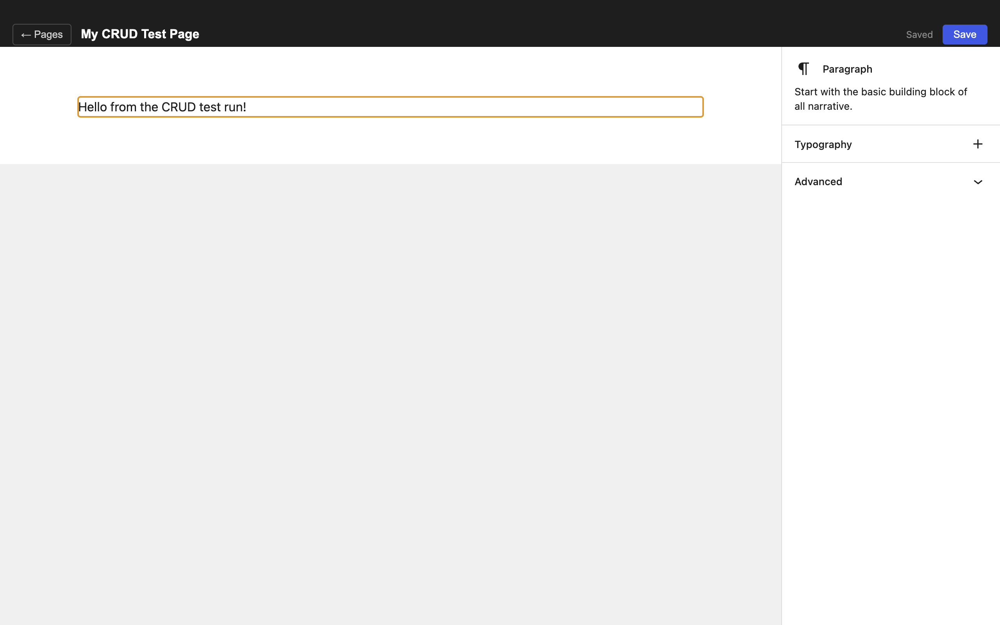
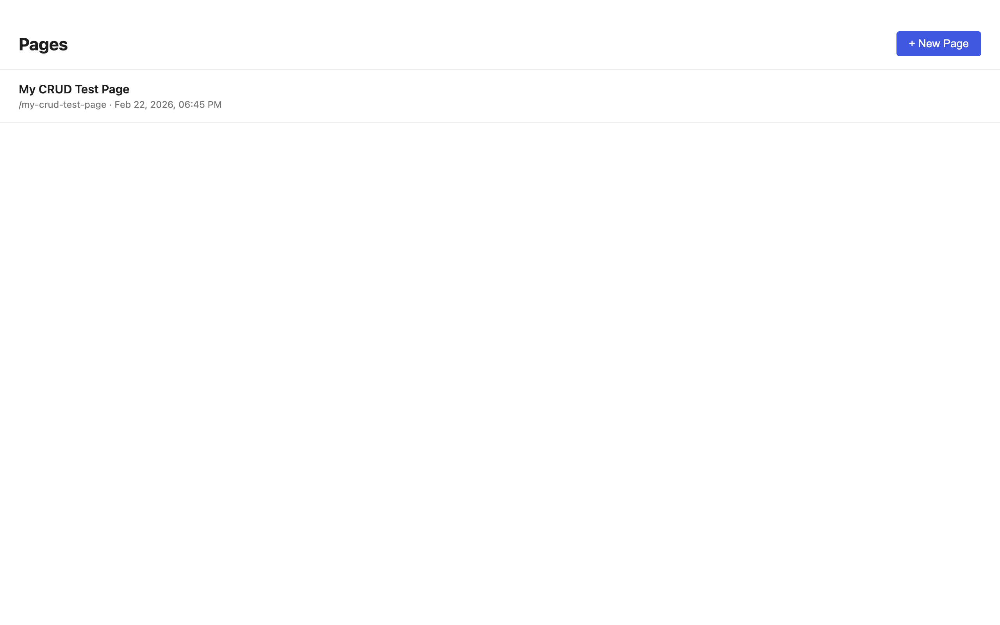

# Block Editor

A standalone Gutenberg editor for the desktop. This experiment takes the block
editor out of WordPress and pairs it with a small page manager and local file
storage inside an Electron app.

No WordPress installation, PHP server, database or account is required.

> **Status:** working prototype, not a production CMS. Run it from source;
> packaged installers, publishing and sync are not provided.



## What it does

- Create, open and delete pages from a simple page list.
- Compose with Gutenberg’s registered core blocks and bundled block patterns.
- Navigate blocks in List View and change settings in the block inspector.
- Edit page titles and automatically derive a slug.
- Autosave changes after 1.5 seconds, save explicitly with the Save button or
  Cmd/Ctrl+S, and save before returning to the page list.
- Choose local images and videos through a native file dialog.

This is a desktop application, **not a browser demo**. Its renderer relies on
Electron’s preload bridge for file access; serving the HTML alone will not
provide a working editor.

## Quick start

Prerequisites: **Node.js 22.12+**, npm, Git and a desktop environment supported
by Electron 33. Development and screenshots were done on macOS; other platforms
have not been verified.

```sh
git clone https://github.com/goodjobdev/block-editor.git
cd block-editor
npm ci
npm run dev
```

The first dependency installation normally downloads Electron. If your npm version
blocks dependency install scripts, review its approval prompt and allow Electron’s
installer (and esbuild’s setup script) before launching the app. No environment
variables or API credentials are needed.

### Commands

| Command | Purpose |
| --- | --- |
| `npm run dev` | Start the renderer development server and Electron |
| `npm run typecheck` | Check the main/preload and renderer TypeScript projects |
| `npm run build` | Build the application into `out/` |
| `npm run preview` | Open the production build in Electron after building |

`npm run build` produces application files, not a signed installer. Rebuild after
cloning rather than relying on the historical build artifacts in the repository.

The `browser-*` npm scripts refer to local helper scripts that are not included
in this repository; they are not needed to run the app. The root-level
`test-crud.mjs` and `inspect-iframe.mjs` are development/debug helpers rather
than a portable automated test suite.

## Local storage

Pages are stored under `app.getPath('userData')/pages/`. On macOS this is
normally:

```text
~/Library/Application Support/block-editor/pages/
├── index.json
└── <page-id>.json
```

Each page file contains:

```ts
interface Page {
  id: string
  title: string
  slug: string
  content: string   // Gutenberg serialized block HTML
  createdAt: string // ISO 8601
  updatedAt: string // ISO 8601
}
```

`index.json` holds the metadata used by the page list. File I/O happens in the
Electron main process via IPC, not through an HTTP server.

**Back up this directory if the content matters.** Deleting a page removes its
file; there is no trash, version history or sync. Media is referenced through
local `file://` URLs, not copied into a managed library. Moving the original
media or opening the page on another computer can break those references.
Remote media or embeds may still make network requests.



## Architecture

```text
src/
├── main/index.ts              # Window, page-file IPC handlers, media dialog
├── preload/index.ts           # Context-isolated electronAPI bridge
├── shared/page.ts             # Page types shared across processes
└── renderer/
    ├── index.html
    └── src/
        ├── App.tsx            # Page-list/editor view routing
        ├── main.tsx           # React root and core-block registration
        ├── blocks/patterns.ts
        ├── lib/               # Autosave and media picker integration
        └── views/
            ├── PageList/
            └── Editor/
```

The stack is **Electron 33**, **React 18**, **TypeScript**, **electron-vite 5**
and **Vite 6**, with the editor supplied by `@wordpress/*` packages.
The editing surface uses `BlockEditorProvider`, `BlockCanvas` and
`BlockInspector`. Gutenberg’s canvas lives in an iframe and receives its
block styles explicitly.

### Dependency constraints

Use npm and the committed `package-lock.json`. React and React DOM are pinned to
**18.3.1** for compatibility with the WordPress packages; do not upgrade to
React 19 independently.

Several Gutenberg packages are deliberately pinned as well. In particular,
`@wordpress/rich-text` must resolve to a single version: duplicate copies can
break rich-text instance checks and cause saved blocks to reopen with a blank
canvas. See [CLAUDE.md](CLAUDE.md) for dependency and Electron configuration notes.
That file also contains historical development notes; the source is authoritative
where older TODOs no longer match the implementation.

The development and preview commands clear `ELECTRON_RUN_AS_NODE` so Electron
launches as an app even when invoked from an Electron-based parent process.

## Limitations

- No publishing, WordPress connection, export workflow, collaboration or sync.
- No managed media library, portable media bundling or packaged releases.
- Some core blocks expect WordPress services and may not work fully standalone.
- Experimental Gutenberg APIs and hand-written type shims are used.
- This is not a hardened viewer for untrusted documents or plugins.
- The bundled Electron and editor versions are prototype-era dependencies;
  review and update their security posture before distributing the app.

## Attribution and licensing

Gutenberg and WordPress are projects of the WordPress community. This is an
independent experiment, not an official WordPress application. Third-party
packages retain their respective licenses.

No project-level license has been selected for this repository. Public source
availability does not grant an additional open-source license to the original
application code.
